# Procedural City Road Network Generator

A **procedural road-network generation and reconstruction system** built in Unity and C#.

The project explores how a structured road network can be generated on a constrained 2D environment while maintaining valid connections between streets and intersections. Rather than placing roads manually, the system uses custom generation rules, spatial masks, adjacency data, and a reconstruction pass to produce and refine a complete road network.

The project was built primarily as an **algorithmic and software-engineering experiment**, with an emphasis on procedural generation, data structures, deterministic behaviour, and debugging complex generation rules.

> **Project focus:** Procedural generation · Algorithms · Data structures · Simulation architecture · C# · Unity

<p align="center">
  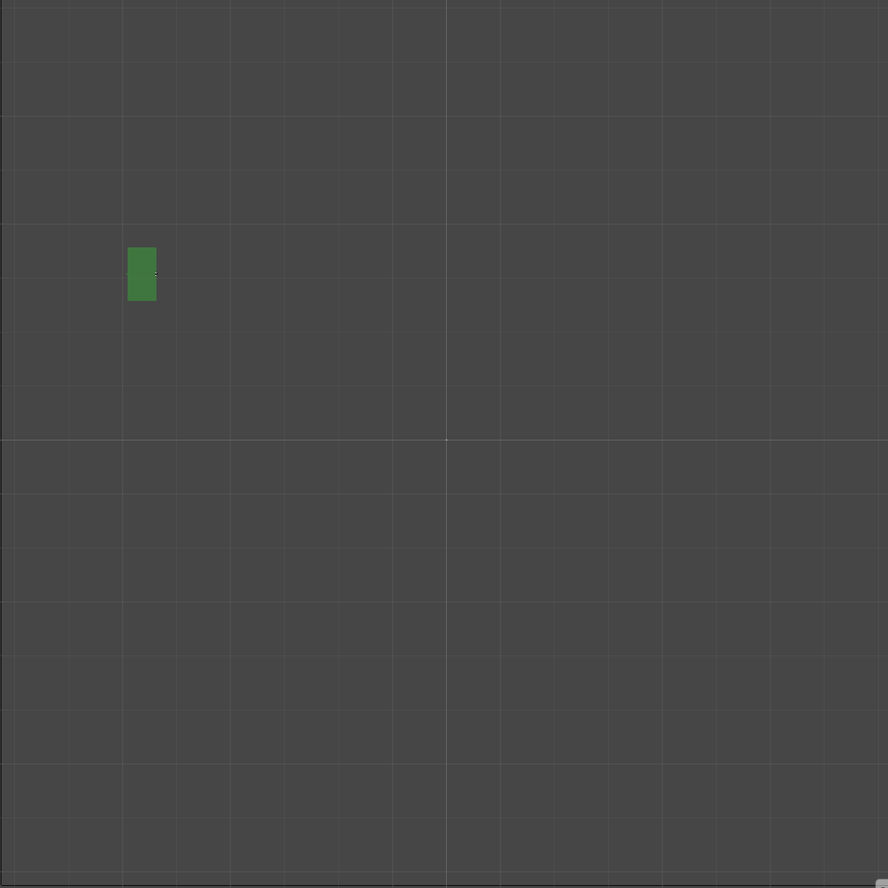
</p>
 
---

## Key Features

- **Procedural road generation** on a configurable grid
- Multiple road configurations:
  - Straight roads
  - 90° turns
  - Dead ends
  - T-junctions
  - X-junctions
- **Constraint-based generation** to control:
  - Road spacing
  - Intersection frequency
  - Turn frequency
  - Consecutive turn directions
  - Intersection probabilities
  - Road looping
- **Road reconstruction pass** for improving generated networks
- Automatic **dead-end detection and connection**
- Configurable connection ranges for reconstructing roads
- **Deterministic generation through configurable random seeds**
- Integer-indexed grid representation instead of relying on individual GameObjects
- **Adjacency-list representation** for the road network
- Bitmask-based cell features using C# `[Flags]` enums
- Spatial masks for detecting whether a proposed road placement has enough space
- Runtime/editor visualization using Unity Gizmos
- **Step-by-step generation mode** for debugging procedural behaviour
- Configurable generation parameters directly through the Unity Inspector

---

## How It Works

The generator is separated into several stages:

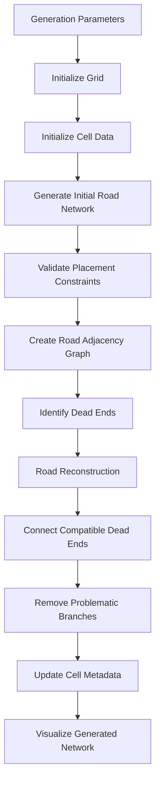

This separation makes the system easier to reason about and allows generation and reconstruction to evolve independently.

---

# Procedural Generation

The core generator starts from an initial intersection and expands the road network through valid neighbouring cells.

For every generated cell, the system evaluates the available directions and determines which road configuration can be placed there.

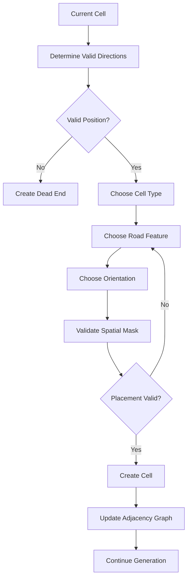

### Generation constraints

The generator does not simply select a random road type.

It maintains state about the network being constructed, including:

- Number of streets since the previous intersection
- Number of turns since the previous intersection
- Previous turn orientations
- Consecutive turns in the same direction
- Previous intersection type
- Distance from previous turns/intersections
- Whether a proposed configuration would cause a road to collide with existing roads

This allows the generator to produce networks with controllable characteristics rather than completely unconstrained random layouts.

---

# Road Types

Road cells are represented through a combination of **cell type, feature flags, and orientation**.

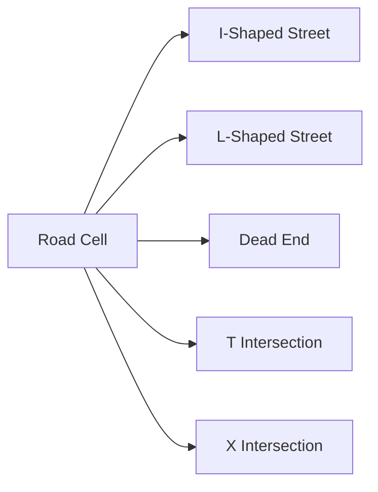

The road shape is represented using the `CellFeature` flags:

```csharp
[Flags]
public enum CellFeature
{
    None = 0,
    IShapedStreet = 1 << 5,
    LShapedStreet = 1 << 6,
    DeadEnd = 1 << 7,
    TShapedIntersection = 1 << 8,
    XShapedIntersection = 1 << 9
}
```

Using bit flags allows a cell to represent multiple independent properties without requiring a large hierarchy of specialized cell classes.

---

# Spatial Validation

One of the more important parts of the generator is determining whether a new road can actually be placed.

Each road configuration has a predefined **spatial mask** describing the cells that must remain available around it.

The masks can then be rotated depending on the orientation of the road.

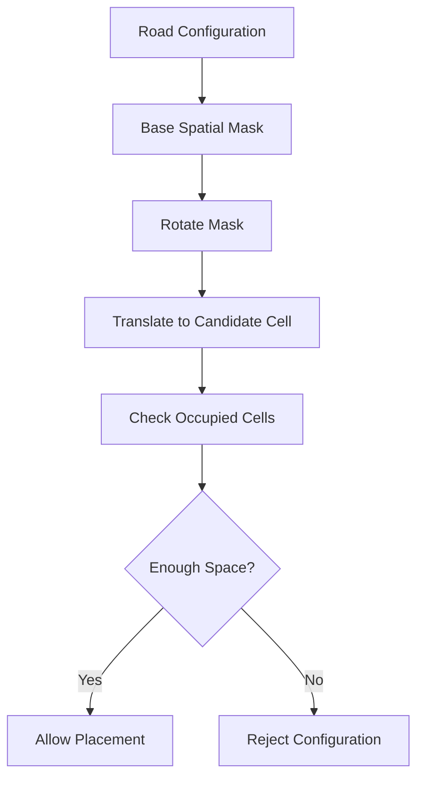

This approach allows the generator to handle more than simple neighbour checks.

For example, a road can be rejected even when its immediate destination cell is empty if the surrounding area would cause the resulting road to overlap or violate the configured spacing constraints.

The mask system is also configurable through the `cellsBetweenRoads` parameter.

---

# Road Network Representation

The road network is stored as an **adjacency graph**.

Each occupied road cell has an entry in:

```csharp
Dictionary<int, List<int>>
```

where the key is the cell index and the value contains the indices of connected road cells.

Conceptually:

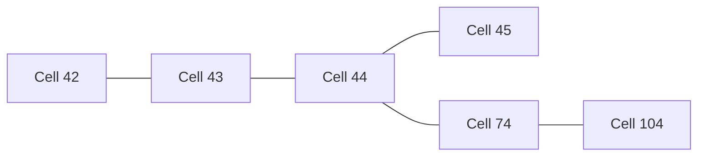

This representation provides a direct relationship between the spatial grid and the logical road network.

It also makes operations such as:

- Finding neighbouring roads
- Traversing a branch
- Detecting dead ends
- Removing branches
- Connecting separate roads
- Reconstructing intersections

straightforward graph operations.

---

# Data-Oriented Grid Representation

Instead of creating a separate Unity `GameObject` for every cell, the simulation stores cell state in flat arrays indexed by a single integer.

For example:

```csharp
private static CellType[] type;
private static float[] travelCost;
private static CellFeature[] features;
private static CellOrientation[] orientation;
private static AgentType[] traversableBy;
```

A 2D position is converted into a single index:

```text
index = y * width + x
```

and can then be converted back when required.

This approach was chosen because the city grid is fundamentally **structured data**, rather than a collection of independent scene objects.

### Benefits

- Lower GameObject overhead
- Contiguous data structures
- Simple indexing
- Easier bulk processing
- Clear separation between simulation state and visualization
- Better foundation for scaling the simulation later

The Unity scene is therefore primarily responsible for **visualization**, while the underlying grid and road network contain the actual simulation state.

---

# Cell State

Each grid cell can contain several independent pieces of information.

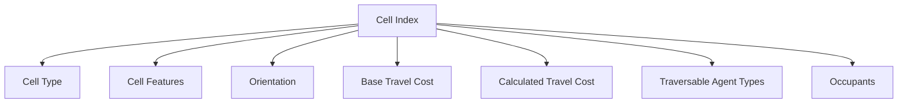

The system currently supports cell categories such as:

- Empty
- Building
- Sidewalk
- Street
- Intersection

Road features can then modify the behaviour of those cells.

For example:

| Feature | Effect |
|---|---|
| Speed bump | Increases travel cost |
| Road work | Increases travel cost |
| Potholes | Increases travel cost |
| Road block | Makes the cell non-traversable |
| Crosswalk | Allows pedestrians to use a street |
| Bench | Reduces sidewalk traversal cost |
| Trees | Reduces sidewalk traversal cost |

This provides a foundation for eventually introducing traffic and pedestrian simulation on top of the generated network.

---

# Road Reconstruction

Procedural generation does not always produce the network characteristics desired by the simulation.

Instead of making the initial generator responsible for solving every possible case, the project uses a separate **reconstruction phase**.

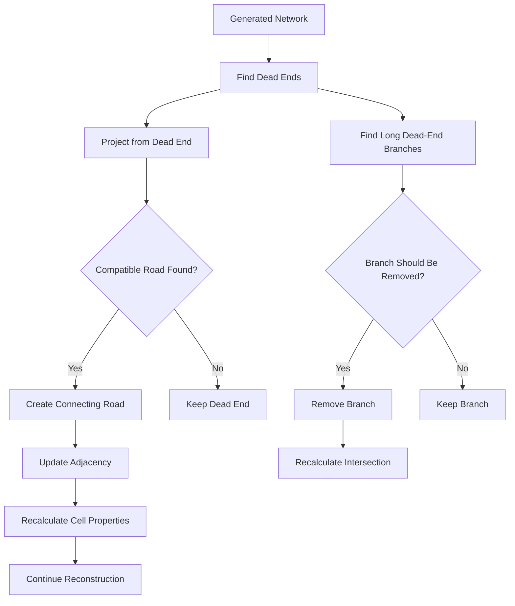

### Dead-end connection

The reconstruction algorithm can project from a dead end to search for another compatible road.

When a valid connection is found, the system:

1. Determines the cells required to connect the roads.
2. Validates the required space.
3. Creates the connecting road cells.
4. Updates the adjacency graph.
5. Recalculates affected cell types and orientations.

### Dead-end cleanup

The reconstruction pass can also identify dead-end branches that exceed configured limits.

Rather than allowing an undesirable branch to remain in the final network, the branch can be removed and the neighbouring intersection or turn recalculated to match the remaining roads.

This separates **network construction** from **network refinement**, which makes the generation logic considerably easier to maintain.

---

# Deterministic Generation

The project supports a configurable random seed.

```csharp
int seed = GameManager.Instance.seed;

if (seed != -1)
{
    RoadGenGlobals.RandomInstance = new System.Random(seed);
}
```

This is particularly useful when debugging procedural systems.

A problematic generated city can be reproduced by recording its seed, allowing the same input to be investigated repeatedly instead of relying on luck to reproduce the issue.

This also makes future automated testing of generation rules more practical.

---

# Debugging & Visualization

Procedural algorithms can be difficult to debug because the final output may hide the sequence of decisions that produced it.

The project therefore includes a **step-through generation mode**.

The generator can pause after individual generation steps, allowing the road network to be inspected as it is constructed.

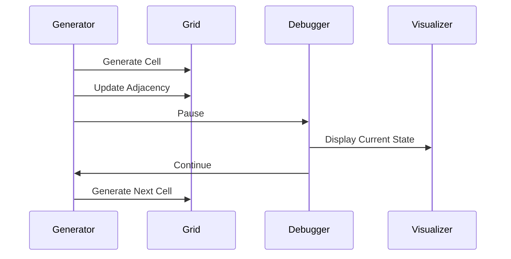

Keyboard controls are also provided for controlling generation during development:

| Key | Action |
|---|---|
| `N` | Advance generation |
| `C` | Continue generation |
| `S` | Skip step-by-step pauses |
| `B` | Return to step-by-step mode |
| `R` | Reset and regenerate |

The project also uses Unity Gizmos to visualize:

- Grid boundaries
- Generated roads
- Road orientations
- Intersections
- Spatial validation masks

This was particularly useful when developing and debugging the procedural placement rules.

---

# Architecture

The main systems are intentionally separated by responsibility.

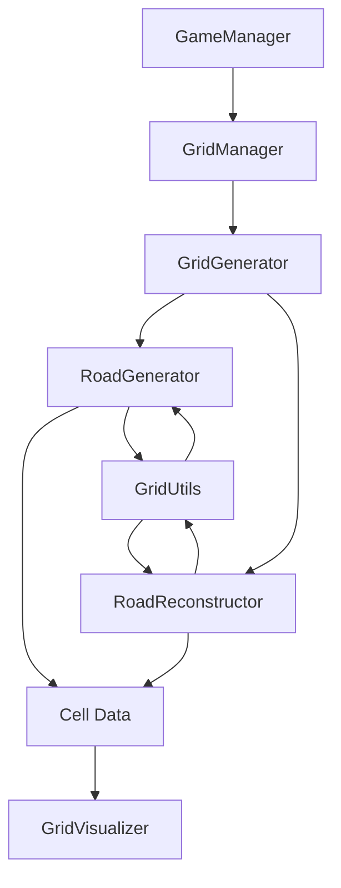

### Main components

| Component | Responsibility |
|---|---|
| `GridManager` | Configuration and lifecycle of the grid generation system |
| `GridGenerator` | Initializes generation and reconstruction parameters |
| `RoadGenerator` | Builds the initial road network |
| `RoadReconstructor` | Connects and removes branches to refine the network |
| `Cell` | Stores the state of every grid cell |
| `GridUtils` | Provides coordinate, direction, rotation and spatial validation utilities |
| `RoadGenCache` | Stores reusable orientation, neighbour and spatial masks |
| `RoadGenGlobals` | Stores generation state and configuration shared by the procedural systems |
| `GridVisualizer` | Visualizes the generated network and debugging information |
| `GameManager` | Controls generation/debugging state |

---

# Configuration

The generation behaviour can be adjusted directly from the Unity Inspector.

Important parameters include:

- Grid size
- Cell size
- Minimum/maximum streets between intersections
- T/X intersection probability
- Straight/turn probability
- Maximum turns between intersections
- Minimum streets between turns
- Consecutive-turn restrictions
- Loop prevention
- Reconstruction connection range
- Dead-end cleanup thresholds
- Road spacing


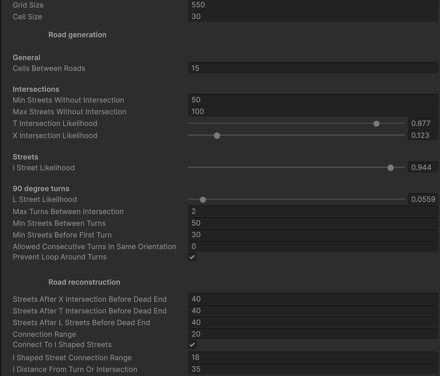


This makes the generator useful not only for producing one fixed city layout, but also for experimenting with how different generation parameters affect the resulting network.

---

# Technology

| Technology | Usage |
|---|---|
| **C#** | Core algorithms and simulation state |
| **Unity 6** | Runtime, visualization and project environment |
| **Unity 2D / URP** | Rendering and scene visualization |
| **Unity Input System** | Development controls |
| **Git** | Version control |

### Unity Version

**Unity 6000.1.15f1**

The project dependencies are managed through Unity's package system.

---

# Project Structure

```text
Assets/
├── Agents/
│   ├── Agent.cs
│   └── Agent Type.cs
│
├── Grid/
│   ├── Cells/
│   │   └── Cell.cs
│   │
│   ├── Grid Generation/
│   │   ├── Grid Generator.cs
│   │   └── Road Generation/
│   │       ├── Road Generator.cs
│   │       ├── Road Reconstructor.cs
│   │       ├── Road Generator Cache.cs
│   │       └── Road Generation Globals.cs
│   │
│   ├── Grid Globals.cs
│   ├── Grid Manager.cs
│   ├── Grid Utils.cs
│   ├── Grid Visualizer.cs
│   └── Tilemap Manager.cs
│
├── Scenes/
│   └── SampleScene.unity
│
└── GameManager.cs
```

---

# Running the Project

### Requirements

- Unity Hub
- Unity **6000.1.15f1**
- A desktop platform supported by Unity

### Setup

1. Clone the repository.
2. Open the project through Unity Hub.
3. Use Unity `6000.1.15f1`.
4. Open:

```text
Assets/Scenes/SampleScene.unity
```

5. Enter Play Mode.

The generated road network can then be inspected through the Unity scene and Gizmo visualization.

---

# Engineering Challenges

The main challenge was maintaining a valid road network while generating it under multiple interacting constraints.

Several rules can affect one another during generation:

- A road may need to turn, but turning can create unwanted loops.
- An intersection may be desirable, but there may not be enough available space.
- A branch may be valid locally but result in an undesirable dead end.
- Connecting two roads may require changing the type and orientation of existing cells.
- Removing a branch can change the structure of a neighbouring intersection.

The generator therefore combines **local spatial validation with global network information**.

Each generated cell contributes to both representations of the city:

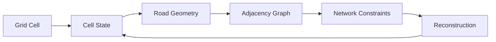

The grid provides efficient spatial queries, and the adjacency graph makes it possible to reason about the connectivity of the generated road network.

This separation also allows the reconstruction system to modify the network without having to regenerate the entire city.

---

# What This Project Demonstrates

This project demonstrates practical experience with:

- **Procedural generation** — creating structured environments from configurable rules
- **Graph algorithms** — representing and modifying road connectivity using adjacency data
- **Spatial algorithms** — validating candidate road placements against surrounding cells
- **Constraint-based systems** — balancing multiple generation rules simultaneously
- **Deterministic randomization** — reproducing generated environments using seeds
- **Bitmask-based state representation** — efficiently representing independent cell features
- **Data-oriented grid representation** — storing simulation state in indexed arrays
- **Network reconstruction** — detecting and resolving undesirable road structures after generation
- **Debugging complex algorithms** — step-by-step generation and runtime visualization
- **Configurable systems** — exposing generation behaviour through reusable parameters
- **C# architecture** — separating generation, reconstruction, utilities, data and visualization into dedicated components
- **Unity integration** — using Unity as the runtime environment and visualization layer

The combination of a spatial grid and graph representation is particularly useful for extending the system beyond road generation. The same network can later serve as the foundation for pathfinding, traffic simulation, pedestrian movement, or other systems that need to reason about connectivity and travel cost.

---

# Future Development

The generated road network provides a foundation for expanding the project into a broader city simulation.

Potential extensions include:

- **Vehicle pathfinding** using the generated road graph
- **Pedestrian navigation** using sidewalks and crossings
- **Traffic lights** and intersection management
- **Dynamic road conditions** such as construction or road blocks
- **Traffic simulation** based on road capacity and travel cost
- **Procedural building placement** around the generated network
- **Population simulation** and travel demand
- **Route selection** based on dynamically changing travel costs
- **Performance benchmarking** on increasingly large city grids
- **Automated tests** for generation invariants and network validity
- **Alternative generation strategies** for comparing procedural algorithms

The existing architecture already provides several of the structures required for these extensions: indexed spatial data, road connectivity, travel costs, traversability information, and configurable generation parameters.

---

## Project Status

**Current status:** Procedural road-network generator

The core generation and reconstruction systems are implemented and functional.

The project currently provides:

- Configurable procedural road generation
- Multiple road and intersection types
- Spatial placement validation
- Road adjacency tracking
- Dead-end detection
- Road reconstruction
- Deterministic generation through seeds
- Runtime debugging and visualization

The broader city-simulation systems are intended as future extensions of the existing road-network foundation.

---

## Why I Built It

I built this project to explore **procedural generation and simulation-oriented software design in C#**.

A road network is a useful procedural-generation problem because relatively simple rules can produce complex structures, while small changes to those rules can have significant effects on the resulting network.

The result is a reusable road-generation system that can serve as a foundation for more complex city and simulation systems.